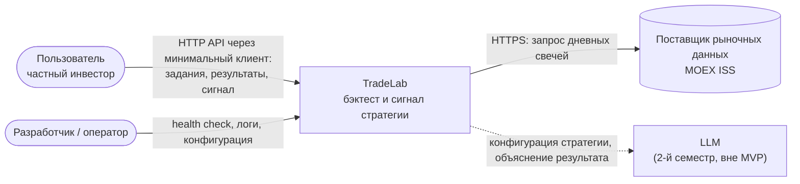
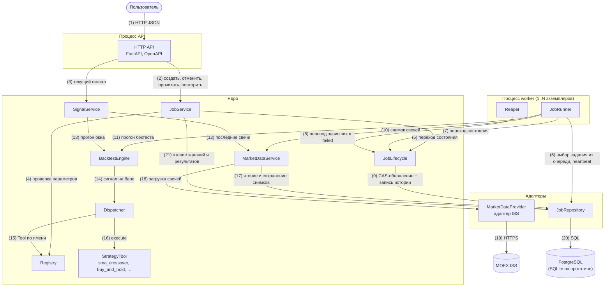
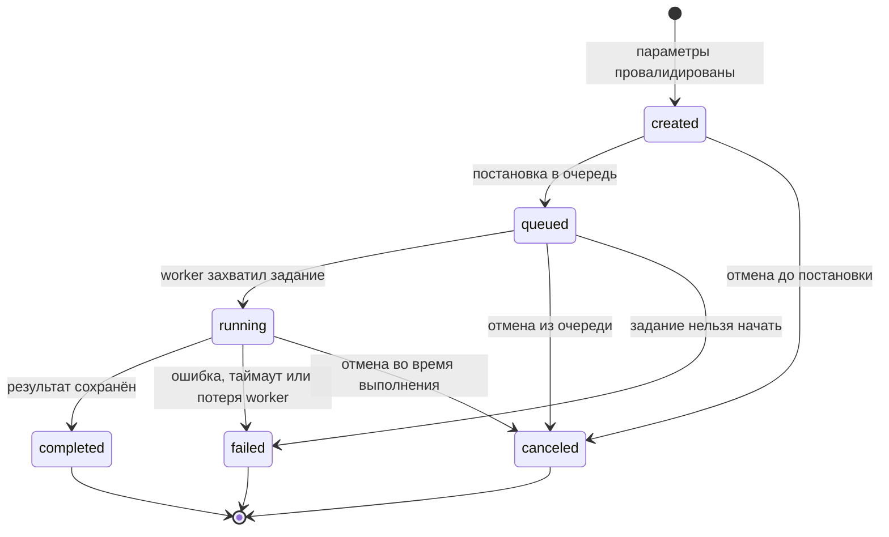

# Архитектура TradeLab

Документ описывает границы системы, её компоненты и правила управления заданием на бэктест (`BacktestJob`). Назначение сервиса — в [concept.md](concept.md), сценарии и критерии приёмки — в [requirements.md](requirements.md), модель выполнения и восстановление после перезапуска — в [ADR 0001](adr/0001-execution-model.md).

## 1. Схема контекста



**Смысл стрелок.** Стрелка идёт от инициатора взаимодействия к тому, кого он вызывает; ответ возвращается по тому же вызову и отдельной стрелкой не рисуется. Подпись — что передаётся и по какому каналу. Пунктир — взаимодействие, которое появится после MVP.

| Стрелка | Что означает |
|---|---|
| Пользователь → TradeLab | Пользователь создаёт и отменяет задания, читает состояние и результат, запрашивает текущий сигнал. Других входов в систему нет: прямого доступа к БД у пользователя нет. |
| Оператор → TradeLab | Проверка живости (health check), чтение структурированных логов с correlation ID, настройка через переменные окружения. |
| TradeLab → MOEX ISS | TradeLab сам запрашивает свечи; поставщик никогда не вызывает TradeLab. Поставщик — внешняя ненадёжная зависимость: таймауты, ограниченные повторы и разбор некорректного ответа выполняются на стороне TradeLab. |
| TradeLab ⇢ LLM | Шов для второго семестра: LLM работает только поверх проверяемых результатов движка и не меняет метрики. |

## 2. Схема компонентов

API и worker — разные процессы. Они не вызывают друг друга напрямую: единственный канал между ними — таблица заданий в БД (см. [ADR 0001](adr/0001-execution-model.md)). Модули ядра — общая библиотека, которую используют оба процесса.



**Смысл стрелок.** Стрелка `A → B` означает, что A синхронно вызывает интерфейс B и зависит от него; B ничего не знает об A. Данные возвращаются результатом вызова. Обратных стрелок нет: ядро не зависит от HTTP, а адаптеры не зависят от ядра. Асинхронность между API и worker не изображена стрелкой, потому что прямого вызова нет: API записывает задание в состоянии `queued`, worker находит его в БД.

| № | Стрелка | Что передаётся |
|---|---|---|
| 1 | Пользователь → HTTP API | Запросы по контракту OpenAPI; ответы и ошибки в едином формате. |
| 2 | HTTP API → JobService | Команды сценариев: создать задание с ключом идемпотентности, отменить, получить состояние и результат, список с фильтрами, повторить запуск. |
| 3 | HTTP API → SignalService | Запрос текущего сигнала: тикер, стратегия, параметры, окно истории. Выполняется синхронно, Job не создаётся. |
| 4 | JobService → Registry | Существует ли стратегия и валидны ли её параметры (`validate_params`) — до создания Job. |
| 5 | JobService → JobLifecycle | Переходы, которые инициирует пользователь: `created → queued` при создании, `* → canceled` при отмене. |
| 6 | JobRunner → JobRepository | Выбор следующего задания из очереди с блокировкой строки (состояние при этом не меняется) и продление аренды (heartbeat). |
| 7 | JobRunner → JobLifecycle | Переходы, которые инициирует worker: `queued → running` (захват — в той же транзакции, что и выбор задания), `queued → failed`, `running → completed` вместе с результатом, `running → failed` с кодом ошибки. |
| 8 | Reaper → JobLifecycle | Перевод в `failed` заданий с истёкшей арендой (`worker_lost`) или превышенным сроком выполнения (`job_timeout`). |
| 9 | JobLifecycle → JobRepository | Условное обновление состояния (compare-and-set) и запись в `JobStatusHistory` в одной транзакции. |
| 10, 12 | JobRunner / SignalService → MarketDataService | Запрос свечей инструмента за период или последнее окно; ответ — проверенный неизменяемый снимок с `snapshot_id`. |
| 11, 13 | JobRunner / SignalService → BacktestEngine | Снимок, нормализованные параметры, капитал и комиссия; ответ — сигналы, сделки, метрики, кривая капитала. |
| 14 | BacktestEngine → Dispatcher | Имя стратегии, префикс закрытых баров, позиция, параметры; ответ — `ToolResult` или `ToolError`. |
| 15 | Dispatcher → Registry | Поиск Tool по имени; неизвестное имя — `unknown_operation`. |
| 16 | Dispatcher → StrategyTool | Вызов `execute` по контракту из `docs/tool-contract.md`. |
| 17 | MarketDataService → JobRepository | Чтение кешированного снимка, сохранение нового снимка со временем получения. |
| 18 | MarketDataService → MarketDataProvider | Загрузка свечей, когда в кеше нет подходящего снимка. |
| 19 | MarketDataProvider → MOEX ISS | HTTPS-запросы с таймаутом и ограниченным числом повторов. |
| 20 | JobRepository → БД | SQL-запросы и миграции. |
| 21 | JobService → JobRepository | Чтение заданий, истории состояний и результатов; поиск по ключу идемпотентности. |

### Ответственность компонентов

| Компонент | Ответственность | Скрываемые детали |
|---|---|---|
| HTTP API | Принимает HTTP-запросы, проверяет схему запроса, переводит ошибки ядра в HTTP-коды и единый формат ошибок, назначает correlation ID. | FastAPI, сериализацию, маршруты, соответствие кодов ошибок HTTP-статусам. |
| JobService | Сценарии работы с заданиями: идемпотентное создание, отмена, чтение, список с фильтрами, повторный запуск как новый Job. | Как ключ идемпотентности сопоставляется с существующим заданием; как собирается карточка задания из Job, результата и истории. |
| JobLifecycle | Единственное место, где меняется состояние Job: проверяет переход по таблице разрешённых, выполняет его атомарно и пишет историю. | Таблицу переходов, условие compare-and-set, транзакцию «состояние + история + результат». |
| JobRunner | Цикл worker: захватывает задание, держит аренду, получает данные, запускает движок, завершает задание. | Опрос очереди, интервалы heartbeat, идентификатор worker, обработку сигналов остановки процесса. |
| Reaper | Периодически находит задания `running`, чей worker пропал или превысил срок, и переводит их в `failed`. | Критерии «зависшего» задания, интервал проверки, источник времени (время БД). |
| SignalService | Сценарий С2: текущий сигнал стратегии на последнем окне данных. | Выбор окна истории, прогон окна от позиции `flat`. |
| BacktestEngine | Прогон стратегии по закрытым барам, исполнение сигналов по `open` следующего бара, капитал, комиссии, сделки, метрики. | Десятичную арифметику, защиту от подглядывания в будущее, формулы метрик. |
| Dispatcher | Вызывает Tool по имени через общий интерфейс, превращает неожиданное исключение Tool в `tool_failed`. | Выбор реализации стратегии; условий по конкретным именам стратегий в нём нет. |
| Registry | Каталог стратегий: имя → Tool, схема параметров, версия. | Список зарегистрированных стратегий и способ регистрации. |
| StrategyTool | Расчёт индикаторов и сигнала на последнем закрытом баре. Не меняет Job, не обращается к БД и поставщику. | Формулы индикаторов и правила конкретной стратегии. |
| MarketDataService | Выдаёт проверенный снимок свечей: из кеша или через поставщика; отклоняет дубли, неположительные цены, неверный OHLC (`invalid_market_data`). | Политику кеширования, правила проверки данных, связь снимка с заданием. |
| MarketDataProvider | Адаптер внешнего поставщика: запрос, таймаут, ограниченные повторы, разбор ответа в свечи. Есть fake-реализация для тестов. | Формат ISS, URL, пагинацию, коды ответов, параметры повторов. Смена площадки — новый адаптер. |
| JobRepository | Хранение заданий, истории состояний, результатов, сделок и снимков; выбор задания из очереди с блокировкой строки. | SQL, миграции, различия PostgreSQL и SQLite, индексы. |

## 3. Жизненный цикл Job

Значения состояний и список разрешённых переходов зафиксированы в [requirements.md](requirements.md#жизненный-цикл-job); здесь — схема, инициаторы переходов и поведение в сбойных ситуациях.



Состояния `completed`, `failed` и `canceled` — терминальные: из них нет ни одной стрелки, кроме выхода из диаграммы.

### 3.1. Разрешённые переходы

| Переход | Инициатор | Когда происходит | Что записывается вместе с переходом |
|---|---|---|---|
| `created → queued` | JobService | Сразу после сохранения задания, в той же транзакции | — |
| `created → canceled` | JobService | Пользователь отменил задание до постановки в очередь | — |
| `queued → running` | JobRunner | Worker атомарно захватил задание | `worker_id`, срок аренды, срок выполнения |
| `queued → canceled` | JobService | Пользователь отменил задание из очереди | — |
| `queued → failed` | JobRunner | Задание нельзя начать: стратегия больше не зарегистрирована (`strategy_unavailable`), снимок для повторного запуска не найден (`snapshot_not_found`) | Код и описание ошибки |
| `running → completed` | JobRunner | Движок рассчитал результат | `BacktestResult`, сделки, `snapshot_id` |
| `running → failed` | JobRunner или Reaper | Ошибка выполнения (`market_data_unavailable`, `invalid_market_data`, `insufficient_data`, `tool_failed`, `internal_error`), превышен срок (`job_timeout`), worker пропал (`worker_lost`) | Код и описание ошибки |
| `running → canceled` | JobService | Пользователь отменил выполняющееся задание | — |

В MVP задание сохраняется и ставится в очередь одной транзакцией, поэтому через API состояние `created` не наблюдается и переход `created → canceled` на практике не встречается. Он остаётся в модели для отложенной постановки — например, если задания сравнения стратегий будут ставиться в очередь только после фиксации общего снимка данных.

Каждый переход выполняется в одной транзакции: условное обновление состояния, запись в `JobStatusHistory` (прежнее и новое состояние, время по часам БД, инициатор, код причины) и сопутствующие данные из последнего столбца. Если транзакция не прошла, не записывается ничего из этого.

Условное обновление — compare-and-set: состояние меняется, только если в БД всё ещё лежит ожидаемое исходное состояние, а для переходов worker — ещё и его `worker_id`. Для переходов Reaper условие дополнительно требует, чтобы аренда (`lease_expires_at < now()`) или срок выполнения (`deadline_at < now()`) были истёкшими в момент записи: если worker успел продлить аренду, Reaper ничего не меняет. Так из двух одновременных переходов побеждает ровно один.

### 3.2. Запрещённые переходы и ошибки

Запрещён любой переход, которого нет в таблице 3.1. Основные случаи:

| Попытка | Почему запрещено |
|---|---|
| `completed`, `failed`, `canceled` → любое состояние | Терминальные состояния не изменяются: результат, ошибка и факт отмены окончательны. |
| `running → queued`, `running → created`, `queued → created` | Возврата назад нет: задание не перезапускается внутри себя, повтор — новый Job. |
| `created → running`, `created → completed`, `created → failed` | Исполнение начинается только после постановки в очередь. |
| `queued → completed` | Результат появляется только у задания, которое реально выполнялось. |
| Переход worker, если задание уже захвачено другим worker | Задание выполняет только тот, кто его захватил. |

Как отклоняется попытка:

- **JobLifecycle** проверяет переход по таблице 3.1 до обращения к БД. Недопустимый переход — ошибка `invalid_transition` с полями `job_id`, `from_state`, `to_state`. В БД ничего не меняется, история не пишется.
- **Гонка.** Переход допустим по таблице, но к моменту записи состояние в БД уже изменилось (compare-and-set не обновил ни одной строки). JobLifecycle перечитывает задание. Если переход в целевое состояние допустим и из нового состояния (например, отмена `queued`, которое worker в этот момент перевёл в `running`), переход повторяется уже от нового состояния; повтор ограничен числом возможных состояний, потому что они меняются только вперёд. Если из нового состояния переход запрещён, возвращается `invalid_transition` с фактическим состоянием.
- **HTTP API** переводит `invalid_transition` в ответ `409 Conflict` с кодом `job_state_conflict`:

```json
{
  "error": {
    "code": "job_state_conflict",
    "message": "Задание в состоянии completed нельзя отменить",
    "details": {
      "job_id": "8f1c…",
      "current_state": "completed",
      "requested_state": "canceled"
    }
  }
}
```

- **Worker и Reaper** не показывают эту ошибку пользователю: для них она означает, что задание уже ушло из их рук. Worker прекращает обработку задания, отбрасывает свои данные и пишет в лог событие `stale_transition` с `job_id`, `worker_id` и фактическим состоянием.
- **Отмена задания в любом терминальном состоянии**, включая уже отменённое, — `409`, как требует [requirements.md](requirements.md#жизненный-цикл-job). Клиент, повторивший отмену после обрыва связи, видит в ответе `current_state: canceled` и понимает, что цель достигнута; история при этом не меняется.

### 3.3. Отмена

1. Пользователь вызывает отмену. JobService выполняет переход в `canceled` из текущего состояния (`created`, `queued` или `running`) через compare-and-set. Если состояние успело смениться на другое нетерминальное (`queued → running`), отмена повторяется от нового состояния и не отклоняется.
2. `created`/`queued` → `canceled`: worker это задание больше не захватит, потому что захватываются только задания в `queued`.
3. `running` → `canceled`: состояние меняется сразу, не дожидаясь worker. Отдельного состояния «отменяется» нет.
4. Worker узнаёт об отмене кооперативно: при очередном heartbeat (продление аренды не находит задание в `running`) и перед каждой записью. После этого он прекращает расчёт.
5. Если worker успел досчитать результат, его переход `running → completed` не проходит compare-and-set, результат не сохраняется. У отменённого задания никогда нет метрик и сделок.
6. Если отмена и завершение пришли одновременно, побеждает тот, чья транзакция зафиксирована первой: задание будет либо `completed` с результатом (и отмена получит `409`), либо `canceled` без результата. Оба исхода видны в истории состояний.

### 3.4. Поздний ответ Tool

Поздний ответ — результат или ошибка StrategyTool (а также ответ MarketDataProvider), которые пришли, когда задание уже не в `running` или уже не принадлежит этому worker: его отменили, Reaper перевёл его в `failed` по `job_timeout` или `worker_lost`.

- Поздний ответ никогда не меняет состояние: переход worker не проходит compare-and-set, потому что исходное состояние уже терминальное.
- Поздний результат не сохраняется: `BacktestResult` и сделки пишутся только в транзакции перехода `running → completed`.
- Поздняя ошибка не превращает `canceled` или `completed` в `failed`.
- Факт фиксируется в логе как `late_result_discarded` с `job_id`, `worker_id`, фактическим состоянием и временем опоздания — по нему видны гонки и медленные стратегии.
- Снимок свечей, который пришёл поздно, можно сохранить в кеш: снимок неизменяем и не принадлежит заданию. Ссылку на него получает только задание, завершённое успешно.

Чтобы зависший Tool не держал задание вечно, у каждого задания есть срок выполнения. Dispatcher проверяет его между вызовами Tool; если зависает один вызов, задание в `failed` с `job_timeout` переводит Reaper. Ответ Tool после этого — поздний.

### 3.5. Падение worker

Worker держит задание по аренде: при захвате записываются `worker_id` и срок аренды, worker продлевает её heartbeat-ом. Сроки берутся по часам БД, чтобы расхождение часов между машинами не влияло на решение.

1. Worker упал или потерял связь с БД — heartbeat прекращается.
2. Reaper (работает в каждом экземпляре worker) находит задание `running` с истёкшей арендой и переводит его `running → failed` с кодом `worker_lost`. Истечение аренды проверяется повторно в самом compare-and-set, поэтому задание, которое worker успел продлить, не трогается.
3. Задания в `queued` не теряются: очередь хранится в БД, их захватит любой живой worker.
4. Перезапущенный worker получает новый `worker_id` и не продолжает свои прежние задания: их судьбу решает Reaper. Чужие задания он не берёт — захват возможен только из `queued`.
5. Если «упавший» worker на самом деле был жив (например, долгая пауза сети), его запись после возвращения — поздний ответ (раздел 3.4) и отбрасывается.

Автоматического перезапуска внутри того же Job нет: задание в `failed` с понятным кодом, пользователь повторяет запуск. Причины выбора и условия пересмотра — в [ADR 0001](adr/0001-execution-model.md).

### 3.6. Повторный запуск и неизменность терминальных состояний

- Повтор запуска упавшего, отменённого или завершённого задания создаёт **новый** Job с новым идентификатором. Он копирует нормализованные параметры, а для проверки воспроизводимости — и `snapshot_id` исходного задания; ссылка на исходное задание хранится в поле `rerun_of`.
- Новый Job проходит жизненный цикл с начала: `created → queued → …`.
- Исходное задание, его история, результат и ошибка не меняются.
- Неизменность терминальных состояний обеспечивается в двух местах: таблица переходов JobLifecycle не содержит переходов из них, а compare-and-set в БД проверяет исходное состояние, поэтому даже запоздавший или ошибочный код не сможет их перезаписать.
