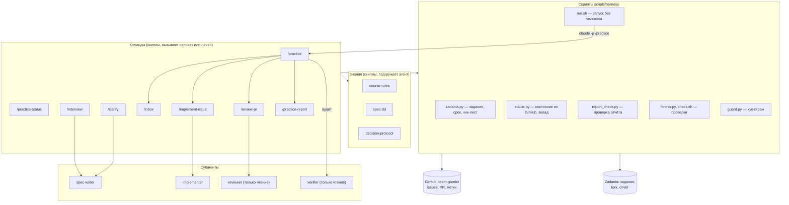
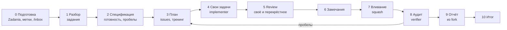
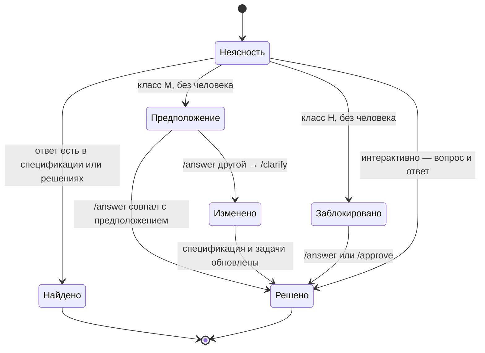

# Харнес команды gambit: практики курса и TradeLab агентами

Харнес — набор команд Claude Code, субагентов, скриптов и правил, который ведёт практику курса от выхода задания
до сдачи отчёта по методу spec-driven development: сначала спецификация, потом задачи, тесты и код, затем независимая
проверка по чек-листу. Работает без человека, а люди подключаются, когда нужно решить что-то о бизнес-требованиях.

## 1. Что харнес делает и чего не делает

| Делает | Не делает |
|---|---|
| Разбирает `tasks/pN.md` из Zadania: срок, чек-лист, шаблон отчёта, пару перекрёстного review | Лекционные ДЗ и отработки — это индивидуальные работы |
| Доводит спецификацию до готовности, планирует задачи с исполнителями и рецензентами | Работу на паре: мини-тесты, `[poker]`, `[job]` |
| Реализует задачи участника, делает review, вливает, сдаёт отчёт из fork | Решения за команду о бизнес-требованиях классов M и H без следа: такие решения видны в `docs/product/decisions/` и в issues |
| Ведёт интервью и разбирает запросы изменений от команды | Необратимые действия: удаление, force-push, push в `main` |

Личное участие засчитывается курсом по PR и review. Всё, что агент сделал от имени участника, видно в итоговой сводке
каждого запуска и в трекинг-issue: участник должен понимать и уметь объяснить свои PR на review и защите (практика 8).

## 2. Что показал разбор Zadania

- **Ритм.** Практика по субботам; задание выкладывается в день пары; срок — воскресенье следующей недели, 23:59 по Екатеринбургу. Одновременно открыты две практики: сдаём прошлую, начинаем новую.
- **Оценка.** Личное участие (4 балла каждую практику) — свой влитый PR или содержательное review по ссылкам в отчёте; с p3 — ещё перекрёстное review чужой команды. Командный балл растёт: 2, 2, 4, 4, 8, 8, 10, 10 — по чек-листу из задания, только по `main` на момент срока.
- **Сдача.** Отчёт `teams/gambit/pN.md` строго по шаблону из своего fork; бот (`tools/check_pr.py`) проверяет папку и непустые разделы; оценку ставит преподаватель меткой.
- **Впереди.** p3 — доменное ядро и тесты злодейств З1–З6 (срок 22.11); p4 — API по контракту, SQLite с миграциями, идемпотентность; p5 — тесты и review у каждого, CI; p6 — адаптер MOEX ISS с timeout/retry и fake; p7 — логи, health check, PostgreSQL, запуск одной командой; p8 — новое требование по жребию, impact analysis, демо.
- **Подход курса** совпадает со spec-driven: требования → контракты и ADR → ядро → API → проверки, плюс атакующая проверка (колода К1–К10, злодейства) и запись того, что предложил ИИ.

## 3. Принципы

1. **Спецификация — источник истины.** Карта спецификаций и порядок работы — скилл `spec-dd`. Каждая задача ссылается на разделы спецификации и пункты чек-листа; каждый тест — на критерий.
2. **GitHub — общее состояние.** Участники запускают харнес на своих машинах, поэтому план, задачи, вопросы и статус живут в issues, PR и метках, а не в локальных файлах. Локально — только журналы запусков (`.harness/state/`, вне git).
3. **Повторяемые фазы.** Каждая фаза сначала смотрит, что уже сделано, и пропускает это. Запуск раз в несколько часов доводит практику до сдачи.
4. **Только от своего имени.** Агент действует как владелец токена: его задачи, его PR, его review. Перехват чужой задачи — только по правилу 48 часов.
5. **Не ждать человека и не решать за него.** Протокол решений (`decision-protocol`): технические мелочи — сам; обратимые продуктовые — предположение и вопрос команде; необратимые — `blocked` и вопрос.
6. **Разделение ролей.** Кто пишет код, тот его не принимает: review — отдельный субагент и другой участник, аудит `main` — отдельный субагент `verifier`.
7. **Ограждения кодом, а не просьбами.** Опасные команды блокирует хук `guard.py`, структуру отчёта проверяет `report_check.py`, архитектурные правила — `fitness.py`.

## 4. Устройство



Стрелка — «вызывает или использует». Пунктир — скиллы-знания подгружаются в контекст агента по мере надобности.

| Файл | Назначение |
|---|---|
| `CLAUDE.md` | Инструкции, которые получает каждый агент в проекте |
| `.harness/config.toml` | Команда, ротация рецензентов, имена переменных с токенами, пороги времени, метки, архитектурные правила |
| `.harness/autonomous.md` | Добавка к системному промпту для запусков без человека |
| `.claude/skills/*` | Команды и знания (см. таблицу в `CLAUDE.md`) |
| `.claude/agents/*` | Субагенты `spec-writer`, `implementer`, `reviewer`, `verifier` |
| `.claude/settings.json` | Разрешения и хук `guard.py` |
| `scripts/harness/*` | Детерминированные части: разбор заданий, сбор состояния, проверки, запуск |
| `docs/product/decisions/` | Решения команды и предположения агентов |
| `.github/ISSUE_TEMPLATE/` | «Вопрос по требованиям» и «Изменение требований» — вход для людей из GitHub |

## 5. Сценарий 1: практика одной командой



Неделя практики при запусках раз в 4 часа:

| Когда | Что происходит |
|---|---|
| Суббота после пары | Первый запуск: разбор задания, задачи по спецификации, трекинг-issue `[pN] …: план и статус`, вопросы команде |
| Вс — чт | Запуски каждого участника: свои задачи → PR → review по ротации → исправления → вливание; перекрёстное review |
| Пт — сб | Аудит чек-листа `main`, задачи на пробелы, перехват задач без PR (меньше 24 часов до срока — порог в конфиге) |
| Вс до 23:59 | Отчёт сдаёт назначенный участник (`members[(N-1) % 3]`), за 6 часов до срока — любой |

### Запуск
```bash
scripts/harness/bootstrap.sh                 # один раз: метки, fork Zadania, remote fork
claude                                       # интерактивно: /practice, /practice-status, /interview …
scripts/harness/run.sh practice              # без человека, от своего имени, самая срочная практика
scripts/harness/run.sh practice p3           # конкретная практика
```
По расписанию (macOS/Linux, `crontab -e`), каждые 4 часа:
```cron
0 */4 * * * cd ~/…/team-gambit && scripts/harness/run.sh practice >> .harness/state/cron.log 2>&1
```

### Сейчас и потом: от чьего имени
- **Сейчас** каждый участник запускает команды у себя: `gh auth login` своим аккаунтом, и харнес работает от его имени — его задачи, его review, его PR.
- **Потом** токены участников можно передать одному запуску. В `.harness/config.toml` у каждого участника есть `token_env` — **имя** переменной. Значение задаётся в окружении (менеджер секретов, `~/.zshenv`, переменная CI), в репозиторий не попадает:
  ```bash
  export GH_TOKEN_SHAALDY=…   # fine-grained token: доступ к team-gambit и своему fork Zadania
  scripts/harness/run.sh practice p3 --as Shaaldy
  scripts/harness/run.sh practice p3 --as all --passes 2   # по очереди за всех: задачи, затем review и вливание
  ```
  `run.sh` выставляет `GH_TOKEN`, автора коммитов (`<id>+<login>@users.noreply.github.com`) и `git push` по https через `gh auth git-credential` — чтобы PR, коммиты и push были от имени участника, а не владельца машины. Значение токена не печатается: это проверяет хук. Первый запуск в этом режиме проверьте вручную: что автор PR и коммитов — нужный участник.

## 6. Сценарий 2: люди уточняют требования

Три входа, один результат: решение в `docs/product/decisions/` + согласованная правка спецификации через PR + перепланирование задач.

| Кто начинает | Как | Что происходит |
|---|---|---|
| Агент, работая без человека | issue `question` (+ `assumption` или `needs-human`) | Обратимое — принято предположение, работа идёт; необратимое — задача `blocked` |
| Агент, по просьбе человека | `/interview` — открытые вопросы; `/interview <тема>` — пробелы спецификации; `/interview feature <что>` — описание функционала; `/interview next` — подготовка к следующим практикам | Вопросы пачками с рекомендуемым вариантом, сводка на подтверждение, PR спецификации |
| Человек | `/clarify <текст>` в Claude Code или issue по шаблону «Изменение требований» | Классификация, impact analysis до кода, недостающие вопросы, решение, PR спецификации, задачи |
| Человек, асинхронно | комментарий `/answer A` или `/approve` в issue-вопросе | `/inbox` (в начале каждого `/practice`) переносит ответ в решения и спецификацию |



## 7. Общее состояние в GitHub

| Метка | Смысл |
|---|---|
| `practice:pN` | Задача, PR или вопрос практики N |
| `harness:tracking` | Трекинг-issue практики: план, распределение, аудит (комментарий `<!-- harness:audit -->`), итоги запусков |
| `question`, `assumption`, `needs-human`, `answered` | Жизненный цикл вопроса команде |
| `change-request`, `triaged` | Запрос изменения от команды и отметка, что он разобран |
| `blocked` | Задача ждёт решения человека |

Всё, что пишет агент, начинается с `<!-- harness -->`: так `/inbox` отличает ответы людей от комментариев агента, хотя аккаунты одни и те же.

## 8. Безопасность

| Что | Как ограничено |
|---|---|
| Push в `main`, force-push, `--mirror`, удаление веток | `guard.py` (хук PreToolUse) и `permissions.deny` в `.claude/settings.json` |
| Сброс изменений: `reset --hard`, `clean`, `checkout --`, `restore`, `stash drop`, `rm -r` вне временных каталогов | `guard.py` |
| Удаление через `gh` и `gh api -X DELETE`, merge не squash, `--admin` | `guard.py` |
| Вывод токенов: `printenv`, `env`, `echo $…TOKEN`, `gh auth token`, `cat .env` | `guard.py`, `permissions.deny` |
| Правка Zadania вне `teams/gambit/` | `guard.py` (запись), `report_check.py` (до PR) |
| Вопрос человеку там, где его нет | `--permission-prompts none` и `.harness/autonomous.md` в `run.sh` |
| Действия вне разрешённого списка в автономном режиме | `--permission-mode dontAsk`: что не разрешено в `settings.json`, то отклоняется без вопроса |

Хук срабатывает и в интерактивных сессиях: это страховка и для людей. Проверки хука — `scripts/harness/tests/test_guard.py`.

## 9. Проверка самого харнеса
```bash
python3 -m unittest discover -s scripts/harness/tests -v   # хук, разбор заданий, проверка отчёта
scripts/harness/check.sh                                   # всё, что есть в репозитории
python3 scripts/harness/zadania.py brief p3                # разбор задания на живых данных
python3 scripts/harness/status.py p2                       # состояние практики из GitHub
```

## 10. Ограничения и что дальше
- Качество работы агентов зависит от спецификации: пробелы в ней превращаются в вопросы. Чем раньше `/interview next`, тем меньше блокировок перед сроком.
- Харнес не видит устных договорённостей: всё, что решили на созвоне, внесите через `/clarify` или issue.
- Запуск `--as` за других участников проверен только на уровне сценария `run.sh`; первый реальный запуск — под присмотром.
- Следующий шаг — расписание в GitHub Actions (`anthropics/claude-code-action@v1`, секреты `ANTHROPIC_API_KEY` и токены участников) вместо cron на ноутбуке.
